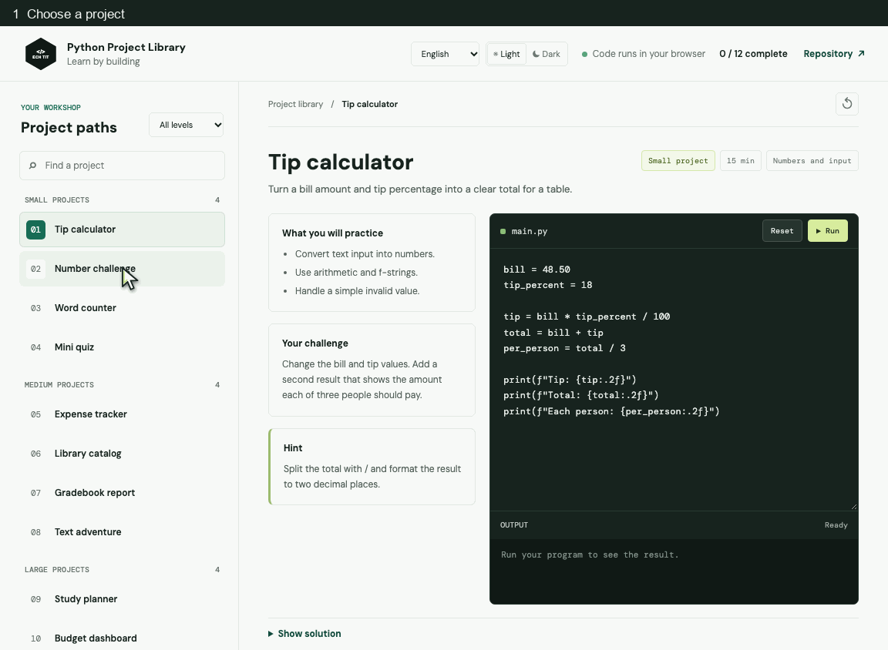
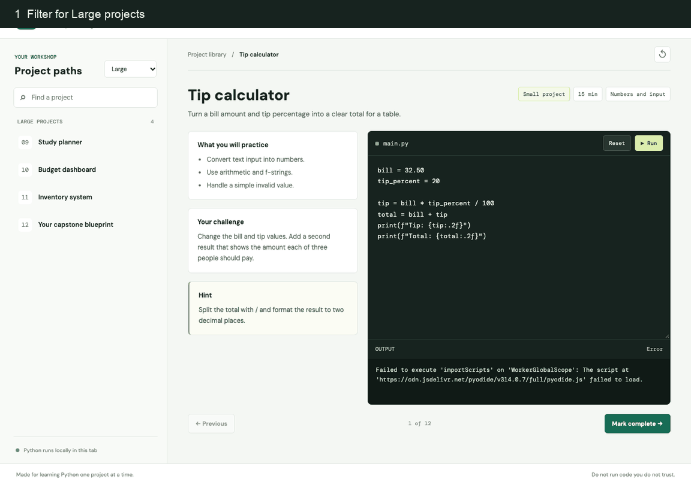

# Python Project Library

Learn Python by building projects, from small exercises to larger applications.

**Live site:** https://thurein2003.github.io/Python_Library_of_ThuReinOo/

[](https://github.com/thurein2003/Python_Library_of_ThuReinOo)

After earning a certificate, learners can star the repository. This live total counts GitHub stars, not verified certificate recipients.

## Try it

1. Choose a project and read its challenge.
2. Edit the Python code and select **Run**.
3. Save progress in this browser and move to the next project.

Enter a learner name before starting. Changing the name resets the saved learning history. Progress stays in this browser and is not included in the site link.
If browser storage is blocked, the site uses temporary tab-only storage and warns you that progress will not persist.

Solutions stay hidden until **Show solution** is selected.

Choose English, Myanmar, or Thai, and switch between light and dark themes. Python runs in your browser with Pyodide; the first run needs an internet connection.

Edit and successfully run all 12 projects before marking them complete to unlock a printable certificate. It reports solution-button clicks saved in this browser.

## Quick guides

**Edit and run a project**



**Choose a larger project and track progress**



## Run locally

```bash
python3 -m http.server 8000 --directory learning-site
```

Open http://localhost:8000.

The original study folders are kept. The learning site is in `learning-site/`.
